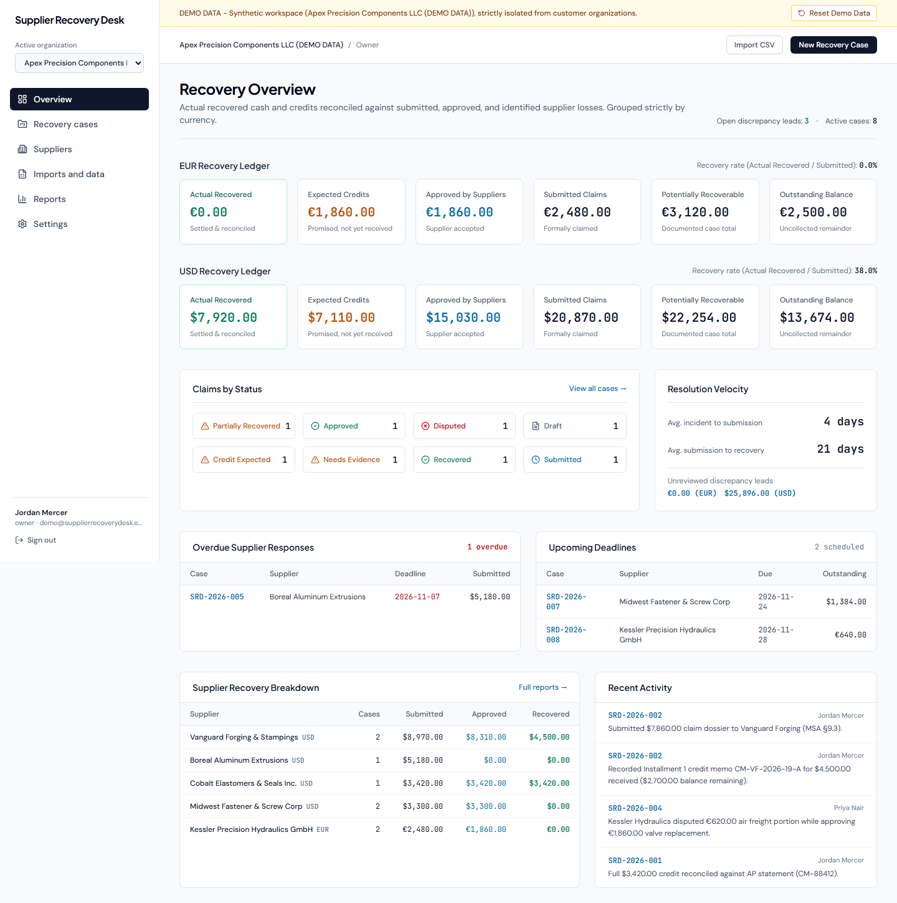
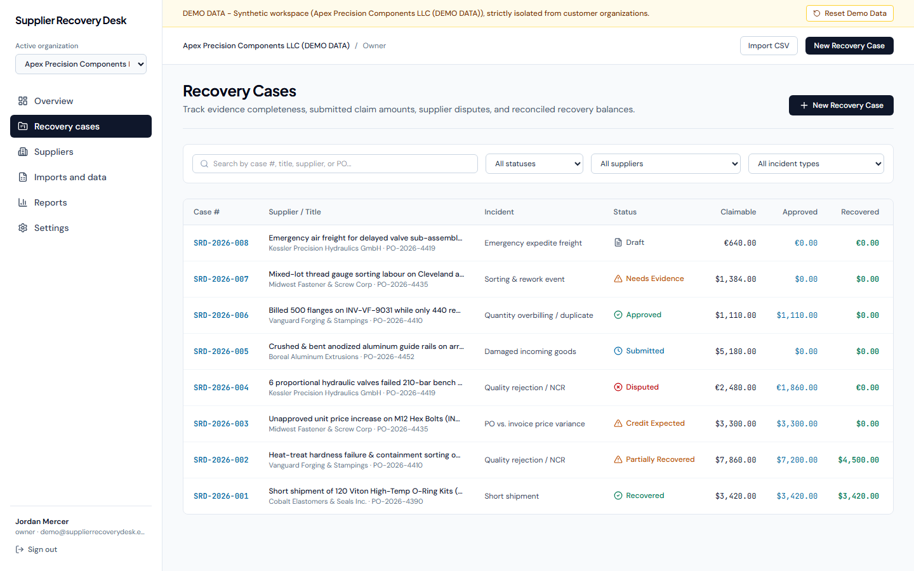
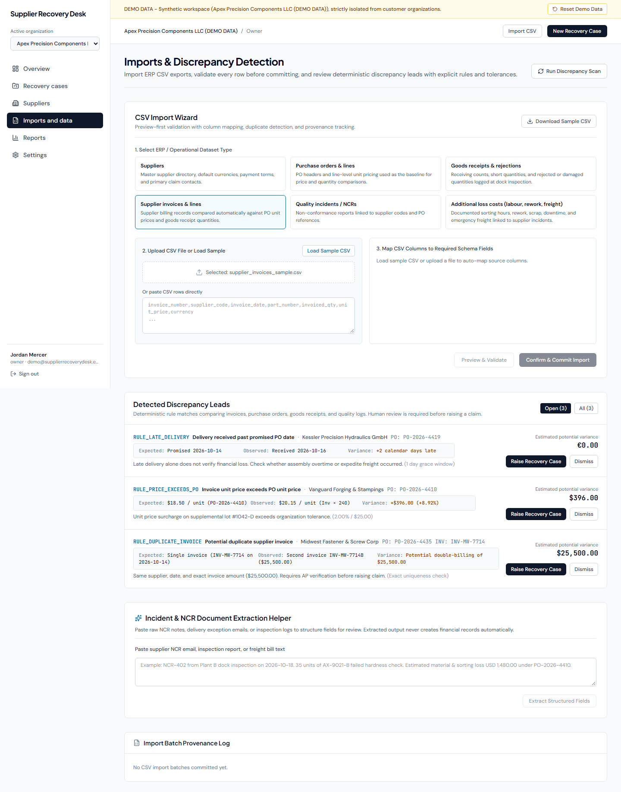
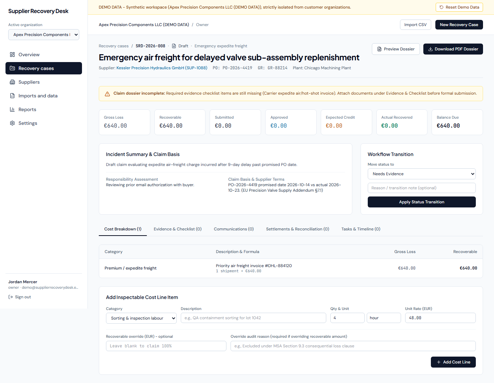

# Supplier Recovery Desk (`supplier-recovery-desk`)

Multi-tenant B2B operational loss & supplier recovery workspace built with Next.js 15 App Router, React 19, TypeScript, Tailwind CSS v4, Drizzle ORM, PostgreSQL / Supabase migrations, Stripe billing, PDF dossier generation (`pdf-lib`), and optional server-side Gemini document assistance (`@google/genai`).

[](https://supplier-recovery-desk.vercel.app)
[](https://github.com/devtechedge/supplier-recovery-desk/actions/workflows/ci.yml)
[](LICENSE)

## Live Demo

**https://supplier-recovery-desk.vercel.app**

Open the demo workspace in one click from the landing page (no sign-up required), or create an organization account.

> **Demo data note:** the hosted demo runs on an embedded, ephemeral SQLite store that resets on cold start and is fully isolated from real customer records. To run with a persistent database, connect a Postgres/Supabase project using the variables in `.env.example`.

## Screenshots






## Core Capabilities

- **Financial Integrity & Multi-Currency Separation**: Strictly separates `Potentially Recoverable`, `Submitted`, `Approved`, `Expected Credits`, and `Actual Recovered` amounts per currency using integer minor-unit arithmetic (`cents`).
- **ERP CSV Import Wizard & Provenance**: Preview-first validation for Suppliers, Purchase Orders, Goods Receipts, Supplier Invoices, Quality Incidents/NCRs, and Additional Loss Costs with column mapping, duplicate protection, error CSV download, and batch provenance.
- **Deterministic Discrepancy Detection**: Explicit rules for invoice price variance, invoice quantity exceeding goods receipt, short shipments, quality rejections/damages, late deliveries, and duplicate invoices-with expected vs. observed values, tolerances, and duplicate-claim prevention.
- **Recovery Case Workspace**: Structured cost-line engine (`material_loss`, `sorting_labour`, `rework_labour`, `scrap`, `production_downtime`, `overtime`, `premium_freight`, etc.), private evidence storage with short-lived HMAC signed URLs, human-approved supplier communications, partial/full settlement reconciliation, tasks, audit timeline, and formal PDF claim dossier export.
- **Multi-Tenant Isolation & RBAC**: Scoped by `organization_id` across API routes, SQL queries, and Supabase RLS migrations, with `owner`, `admin`, `analyst`, `finance`, and `read_only` roles.
- **Isolated Demo Data**: `Apex Precision Components LLC (DEMO DATA)` includes realistic synthetic data across USD and EUR and can be reset without touching real customer organizations.

## Local Development Setup

```bash
bun install
cp .env.example .env.local
bun run seed
bun run dev
```

Open `http://localhost:3000`. Use **Open Live Demo** on the landing page or sign in at `/auth/signin`.

## Environment Variables

See `.env.example` for all supported variables:

- `AUTH_SESSION_SECRET`: HS256 secret for session cookies and evidence download signatures.
- `DATABASE_URL` / `NEXT_PUBLIC_SUPABASE_URL` / `NEXT_PUBLIC_SUPABASE_ANON_KEY` / `SUPABASE_SERVICE_ROLE_KEY`: PostgreSQL / Supabase connection & private bucket configuration. Without these, the app runs locally on persistent SQLite (`.data/srd.db`) and private local evidence storage (`.data/evidence/`).
- `STRIPE_SECRET_KEY`, `STRIPE_WEBHOOK_SECRET`, `STRIPE_PRICE_STARTER`, `STRIPE_PRICE_GROWTH`, `STRIPE_PRICE_SCALE`: Stripe subscription billing. Without these, **Development Billing Mode** is explicitly enabled for local entitlement testing.
- `GEMINI_API_KEY`: Optional server-side `@google/genai` key for NCR extraction and draft assistance (disabled automatically if not set or toggled off in Settings).
- `RESEND_API_KEY`, `EMAIL_FROM`: Optional outbound email dispatch after human approval.

## Verification & Quality Gates

```bash
bun run lint
bun run typecheck
bun run test
bun run build
```

## Production Deployment (Supabase + GitHub + Vercel)

1. Apply PostgreSQL schema and RLS migrations in `supabase/migrations/` to your Supabase project (`supabase db push` or SQL Editor for `0001_initial_schema.sql` and `0002_rls_and_storage.sql`).
2. Push this repository to GitHub (`devtechedge/supplier-recovery-desk` on branch `main`):
   ```bash
   git remote add origin https://github.com/devtechedge/supplier-recovery-desk.git
   git push -u origin main
   ```
3. Import `devtechedge/supplier-recovery-desk` into Vercel, configure production environment variables from `.env.example`, and deploy (`vercel --prod`).
